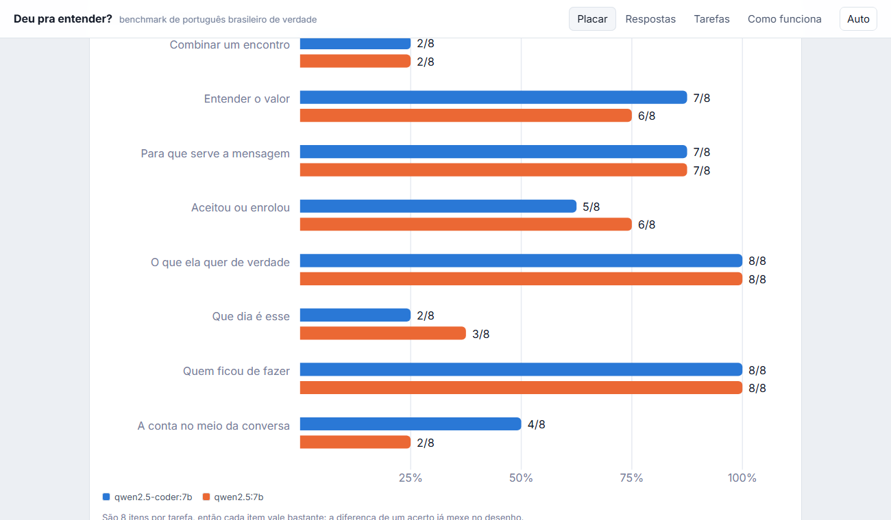
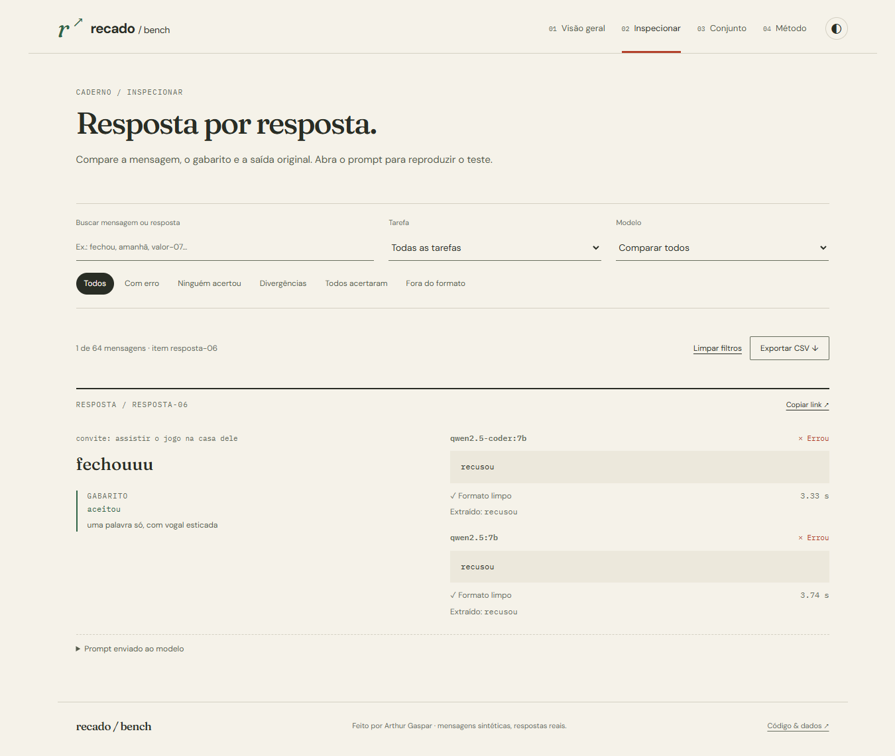

# Recado bench

Um caderno de avaliação de compreensão de mensagens em português brasileiro informal: abreviações, pedidos indiretos, valores, datas e contas dentro de uma conversa.

**64 itens · 8 tarefas · correção por regra · respostas brutas publicadas**

[Explorar as rodadas](https://arthurgaspar.github.io/pv-bench/)



## Usar o caderno

- **Visão geral:** resultados por modelo e matriz de acerto ou formato. Cada marca abre o item correspondente.
- **Inspecionar:** busca por mensagem, ID, observação ou resposta; filtros por tarefa, modelo, erro, divergência e formato. O endereço preserva o recorte para compartilhar.
- **Exportar CSV:** baixa as respostas do recorte atual, com gabarito, texto original, valor extraído e tempo.
- **Conjunto e método:** exemplos com contexto, critérios de correção e registro das rodadas.



## Rodadas incluídas

Executadas localmente via Ollama em 29/10/2026. O tempo depende da máquina e das condições da execução.

| Modelo | Acertos | Formato limpo | Tempo / item |
|---|---|---|---|
| qwen2.5-coder:7b | 43/64 (67%) | 88% | 6,0 s |
| qwen2.5:7b | 42/64 (66%) | 100% | 4,9 s |

Os dois acertaram os oito itens de pedido indireto e os oito de resolução de nomes. Cada um acertou apenas dois dos oito compromissos. Em 15 itens, ambos erraram; em 13, os resultados diferem. A mensagem “fechouuu”, por exemplo, foi classificada como recusa pelos dois.

Esses achados descrevem as rodadas incluídas. Um item vale 1,5625 ponto percentual; a diferença de um acerto não sustenta uma conclusão geral sobre os modelos.

## Executar

Python 3.12 e Node.js 22. Para execução local, instale o Ollama e baixe o modelo escolhido. A montagem do site e os testes não chamam modelos.

```powershell
python -m venv .venv
.venv/Scripts/Activate.ps1
# No Linux/macOS: source .venv/bin/activate
pip install -r requirements.txt

# Opcional: gerar uma nova rodada com um modelo instalado
python -m bench.run --modelos ollama/qwen2.5:7b

# Conferir e montar os resultados versionados
python -m pytest -q
python -m bench.build

cd web
npm ci
npm run dev
```

`python -m bench.run --tarefas valor contagem` limita a execução a essas tarefas. Rodadas parciais ficam fora do placar. Uma nova execução do mesmo modelo substitui seu arquivo em `data/resultados/`.

Outros provedores podem ser usados pelo LiteLLM, configurando a chave no ambiente e passando o nome com `--modelos`. Isso pode gerar cobrança do provedor.

### Lotes, retomada e importação

```powershell
# Vários modelos, cada um com sua configuração (veja lotes/exemplo.json)
python -m bench.lote lotes/exemplo.json --so-validar
python -m bench.lote lotes/exemplo.json --pular-prontos

# Respostas geradas fora deste harness: JSON, JSONL ou o CSV exportado pelo site
python -m bench.importar respostas.jsonl --modelo provedor/modelo --so-validar
python -m bench.importar respostas.jsonl --modelo provedor/modelo
```

Cada resposta é gravada em `data/resultados/.parcial/` assim que chega. Se uma execução for interrompida, o mesmo comando retoma de onde parou e refaz só as chamadas que falharam no provedor; `--do-zero` descarta o parcial. `--paralelo N` faz N chamadas simultâneas, útil em APIs remotas.

A importação recorrige tudo a partir do texto bruto e não aceita notas de fora; divergências aparecem como aviso. Item desconhecido, tarefa trocada, duplicata, campo com tipo errado ou prompts de outra versão do conjunto impedem a gravação, e nenhum arquivo é gravado se qualquer rodada do arquivo tiver erro. Resultado existente só é substituído com `--substituir`.

### Plugins de avaliador

Cada tipo de resposta tem um avaliador (`bench/avaliadores.py`): `extrair` tira o valor do texto, `conferir` compara com o gabarito e `validar_item` confere o gabarito ao carregar o conjunto. Um plugin registra avaliadores novos com `registrar_avaliador` e tarefas com `registrar_tarefa`. Ele é carregado por `--plugins modulo`, pela variável `RECADO_PLUGINS`, pelo entry point `recado_bench.avaliadores` ou pelo campo `plugins` do conjunto; este último é o que vale para o CI, que monta o site sem argumentos. Exemplo em `exemplos/plugin_hora.py`.

Para compilar o site: `cd web` e `npm run build`. O GitHub Actions testa o harness e publica o site a partir dos resultados versionados.

## Correção e integridade

**Versões.** `data/items.json` tem cabeçalho com `esquema`, `nome` e `versao`, e cada rodada nova grava o conjunto com que foi feita, incluindo a impressão: um hash dos prompts exatos enviados ao modelo. Uma rodada cuja impressão não bate com o conjunto atual é recusada na montagem e na importação. Gabarito e `pega` ficam fora do hash, porque as notas sempre são recalculadas; mudar mensagem, contexto ou template exige rodar de novo. Rodadas anteriores ao esquema não têm impressão e passam só pela conferência item a item. Os formatos estão descritos em `bench/esquema.py`.

**Acerto** compara o valor extraído com o gabarito. A extração tolera texto adicional. Respostas com vários campos precisam acertar todos; não há crédito parcial.

**Formato limpo** verifica o formato aceito pelo parser, separadamente do acerto. Espaços externos e cercas de Markdown são removidos antes da verificação. Uma resposta errada pode ter formato limpo.

O parser numérico aceita formatos brasileiros e ingleses: `1.500` é interpretado como 1500; `1,5`, como 1.5. Os detalhes da extração estão em `bench/grade.py`.

A montagem recalcula as notas a partir das respostas brutas, verifica a identidade e a tarefa de cada item e rejeita duplicatas de itens ou modelos. Apenas rodadas com cobertura exata do conjunto entram no site. Novas execuções preservam o texto completo retornado pelo modelo.

Os testes cobrem parsers, coerência dos gabaritos, distribuição das alternativas e integridade das rodadas publicadas.

## Estrutura

```text
bench/tasks.py      prompts e tipos de resposta das oito tarefas
bench/grade.py      extração e comparação com o gabarito
bench/avaliadores.py interface e registro dos avaliadores, carga de plugins
bench/esquema.py    esquemas versionados do conjunto e das rodadas
bench/dataset.py    carregamento e validação dos itens
bench/run.py        execução via LiteLLM, paralelismo e retomada
bench/lote.py       execução em lote a partir de uma especificação
bench/importar.py   importação validada de resultados externos
bench/build.py      validação das rodadas e geração do JSON do site
data/items.json     conjunto manual versionado
lotes/              especificações de lote
exemplos/           plugin de exemplo
data/resultados/    rodadas incluídas no projeto
web/src/            interface React e estilos
tests/              testes do corretor, conjunto e publicação
```

## Limites

- Mensagens sintéticas escritas à mão, sem amostragem representativa de conversas, regiões ou grupos sociais.
- Uma tentativa por item, temperatura zero, sem estimativa da variação entre execuções.
- Respostas curtas e verificáveis; o teste não avalia escrita, diálogo aberto ou toda a compreensão do português.
- O parser também pode falhar. Prompts, respostas brutas e valores extraídos permitem examinar a correção.
- Itens públicos podem aparecer em dados de treino futuros.
- Tempos sem controle de hardware; não são um ranking de velocidade.

Criado por [Arthur Gaspar](https://github.com/arthurgaspar).
